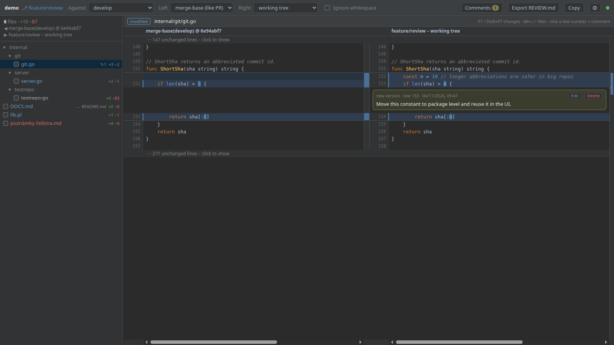
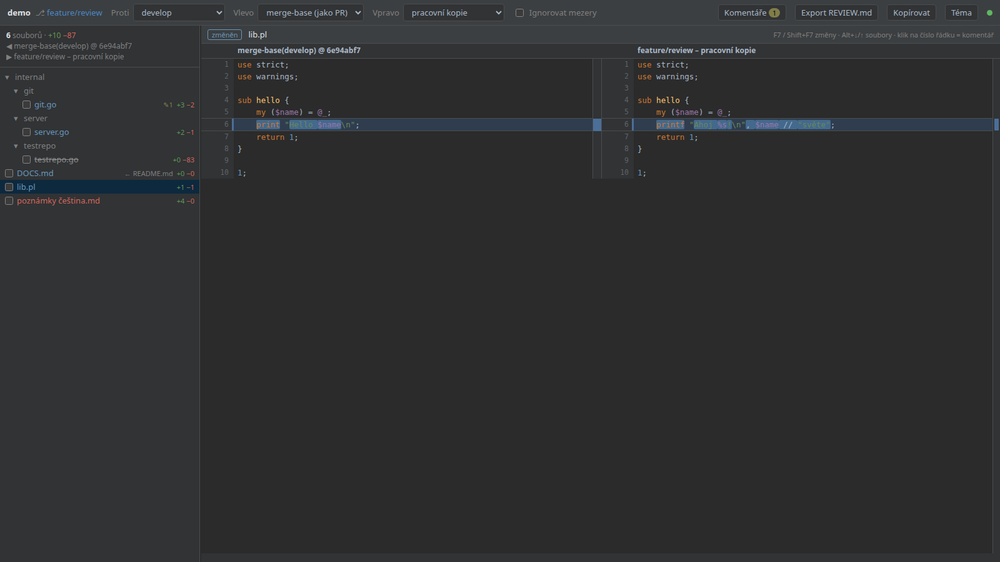
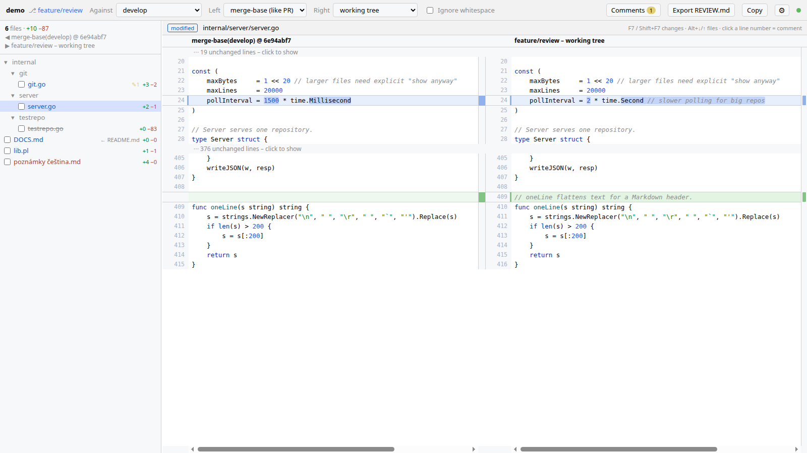
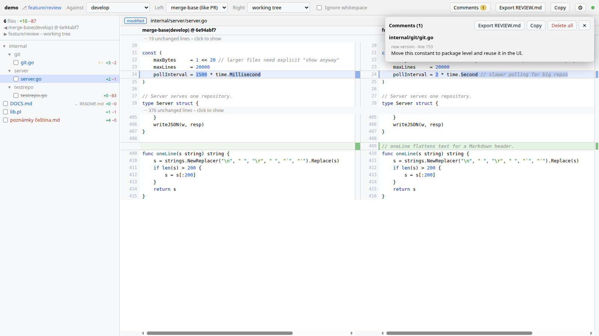

# gitreview

[](https://github.com/JanVrana/gitreview/releases/latest)
[](go.mod)
[](LICENSE)


[English](README.md) · **Čeština**

Webový nástroj pro review změn aktuální git větve proti `develop` / `master`. Diff se zobrazuje vedle sebe (vlevo originál, vpravo změny) ve stylu IntelliJ. Je určený pro kontrolu práce Claude Code na VM, kde nejsou po ruce desktopové nástroje.

Výsledkem je jedna Go binárka bez závislostí, frontend je v ní zabudovaný (offline, žádné CDN).



<table>
<tr>
<td><br><sub>Zvýraznění změněných slov uvnitř řádku</sub></td>
<td><br><sub>Světlé téma, sbalené nezměněné úseky</sub></td>
<td><br><sub>Panel komentářů a export REVIEW.md</sub></td>
</tr>
</table>

## Instalace

Linux / macOS (amd64, arm64):

```bash
curl -fsSL https://raw.githubusercontent.com/JanVrana/gitreview/main/install.sh | sh
```

[Skript](install.sh) stáhne binárku z posledního releasu, ověří její SHA-256 součet a nainstaluje ji do `~/.local/bin`. Jiný adresář nastavíš přes `GITREVIEW_INSTALL_DIR`, konkrétní verzi přes `GITREVIEW_VERSION=v0.2.0`, např.:

```bash
curl -fsSL https://raw.githubusercontent.com/JanVrana/gitreview/main/install.sh | GITREVIEW_INSTALL_DIR=/usr/local/bin sudo -E sh
```

Bez skriptu můžeš binárku stáhnout přímo:

```bash
mkdir -p ~/.local/bin && curl -fL -o ~/.local/bin/gitreview \
  "https://github.com/JanVrana/gitreview/releases/latest/download/gitreview-$(uname -s | tr A-Z a-z)-$(uname -m | sed 's/x86_64/amd64/;s/aarch64/arm64/')" \
  && chmod +x ~/.local/bin/gitreview && gitreview -version
```

Pokud `~/.local/bin` nemáš v `PATH`, dej binárku jinam (např. `sudo` do `/usr/local/bin`). Kontrolní součty jsou v `SHA256SUMS` u každého releasu.

S nainstalovaným Go (1.26+):

```bash
go install github.com/JanVrana/gitreview@latest
```

Go uloží binárku do `$(go env GOBIN)`, a když `GOBIN` není nastavené, do `$(go env GOPATH)/bin`. Obvykle je to `~/go/bin/gitreview` a `~/go/bin` často není v `PATH`. Spusť ji celou cestou, nebo adresář přidej do `PATH`:

```bash
~/go/bin/gitreview -version                                   # přímé spuštění
echo 'export PATH="$(go env GOPATH)/bin:$PATH"' >> ~/.bashrc  # nebo přidání do PATH (zsh: ~/.zshrc)
source ~/.bashrc && gitreview -version
```

Ze zdrojáků: `git clone https://github.com/JanVrana/gitreview && cd gitreview && make build`.

gitreview se **aktualizuje sám** (viz [Automatické aktualizace](#automatické-aktualizace)); `gitreview -update` aktualizuje hned. Funguje i znovu spustit instalační příkaz.

## Spuštění

```bash
gitreview /cesta/k/repu          # výchozí: aktuální adresář, port 8765, 0.0.0.0
gitreview -p 9000 -b 127.0.0.1 .
```

Potřebuje jen `git` v `PATH`.

Při startu se vypíšou URL (IP adresy VM) i s přístupovým tokenem, např. `http://192.168.1.20:8765/?token=3f9c…`. Otevři některou z nich v prohlížeči. Prohlížeč si token uloží do cookie, takže příště stačí i adresa bez tokenu.

| Přepínač | Význam |
|---|---|
| `-p` | port (výchozí `8765`) |
| `-b` | adresa, na které server poslouchá (výchozí `0.0.0.0`) |
| `-allow-host` | další povolená jména v hlavičce `Host`, oddělená čárkou |
| `-token` | pevný přístupový token místo náhodného (také `GITREVIEW_TOKEN`); záložky pak fungují i po restartu |
| `-no-auth` | bez tokenu: UI může používat každý, kdo se dostane na port |
| `-no-auto-update` | neinstalovat nové verze automaticky (také `GITREVIEW_NO_AUTO_UPDATE=1`) |
| `-update` | hned nainstaluje poslední verzi a skončí |
| `-version` | vypíše verzi a skončí |

**Bezpečnost:** každý požadavek potřebuje **přístupový token**. Ve výchozím stavu se při každém startu vygeneruje náhodný a vypíše se v URL. Pevný nastavíš přes `-token` nebo `GITREVIEW_TOKEN` (raději proměnnou, argumenty jsou vidět v `ps`). Token se přijímá jako `?token=` (vymění se za HttpOnly cookie a z adresy zmizí), jako cookie, nebo pro skripty jako `Authorization: Bearer <token>`.

`-no-auth` token vypne, třeba na privátní VM nebo za SSH tunelem (`-b 127.0.0.1` + `ssh -L 8765:localhost:8765 vm`). Server běží na prostém http, takže v nedůvěryhodné síti jde token odposlechnout; tam použij tunel.

Další ochrany, aktivní i s `-no-auth`:
- Zápisy (komentáře, export) přijímá jen jako JSON ze stejného originu. Cizí web otevřený v prohlížeči tak nemůže podstrčit text do REVIEW.md.
- Přístup přes doménové jméno je kvůli DNS rebindingu povolený jen pro IP adresy, `localhost` a hostname stroje. Další jména povolíš přes `-allow-host vm.firma.cz,dev-vm`.
- Číst lze jen soubory ze seznamu změn.
- Sám od sebe se server pracovní kopie ani checkoutnuté větve nedotkne: zapisuje `REVIEW.md`, `.git/gitreview/comments.json` a při **Fetch** remote-tracking větve a fast-forward lokálních base větví. Všechno ostatní (commit, revert, push, pull, stash) jen na tvoje kliknutí, viz [Git operace](#git-operace).

## Automatické aktualizace

Běžící gitreview 30 sekund po startu a pak každých 6 hodin zkontroluje, jestli na GitHubu není nový release. Když ano:

1. stáhne binárku pro tvou platformu a ověří ji proti `SHA256SUMS` daného releasu,
2. nahradí svůj spustitelný soubor (atomicky, ve stejném adresáři),
3. restartuje se na místě se stejnými argumenty, portem i přístupovým tokenem.

Otevřené stránky se samy znovu připojí a načtou novou verzi. Pokud zrovna píšeš komentář, počkají, až ho uložíš nebo zrušíš.

- Vývojové buildy (`make build` z pracovní kopie, verze `dev` nebo `v…-dirty`) se samy neaktualizují.
- Adresář s binárkou musí být zapisovatelný pro uživatele, pod kterým gitreview běží (platí pro `~/.local/bin` i `~/go/bin`, ne pro `/usr/local/bin` instalované přes `sudo`). Jinak se aktualizace přeskočí a důvod se vypíše do logu.
- Vypnout jde přes `-no-auto-update` nebo `GITREVIEW_NO_AUTO_UPDATE=1`.
- **⚙ → Zkontrolovat aktualizace** zkontroluje hned a nabídne **Aktualizovat teď** (funguje i s vypnutými automatickými aktualizacemi).

## Co umí

- **Porovnání:**
  - base `develop` / `master` / `main` / libovolná větev (fallback na `origin/<větev>`),
  - vlevo *merge-base* (jako PR) nebo *špička base*,
  - vpravo *pracovní kopie* (včetně necommitnutých a nových souborů) nebo *HEAD*,
  - přepínač *Ignorovat mezery*.
- **Fetch:** spustí `git fetch --all --prune` a fast-forwardne lokální `develop` / `master` / `main` (a zvolenou base) na stav z remote, takže porovnáváš proti aktuální podobě větve na remote, ne proti staré lokální kopii. Větev s lokálními commity nebo právě checkoutnutou nechá být a nahlásí to. Když je lokální base pozadu za remote (podle posledního fetche), ukáže se u výběru větve `↓N`. Fetch potřebuje neinteraktivní přihlášení (ssh agent, credential helper), na heslo se nikdy neptá.
- **Seznam souborů:** strom souborů s barvami stavů jako v IntelliJ, počty +/− a checkbox „zkontrolováno“. Ten se sám zruší, když se soubor znovu změní.
- **Diff:**
  - zarovnané bloky změn se zvýrazněním změněných slov a zvýrazněním syntaxe (highlight.js),
  - sbalené nezměněné úseky; tlačítko **⇕ Celý soubor** rozbalí celý soubor (volba se pamatuje),
  - tlačítka **↑ / ↓** s počítadlem změn (3 / 12) pro skoky mezi změnami,
  - přehledová lišta změn vpravo,
  - nezávislý horizontální scroll stran.
- **Auto-refresh:** když Claude změní soubor, commitne nebo přepne větev, UI se samo obnoví (polling ~1,5 s přes SSE).
- **Review komentáře:**
  - klikem na číslo řádku přidáš komentář,
  - **Export REVIEW.md** zapíše komentáře do kořene repa a v Claude pak stačí napsat *„zapracuj REVIEW.md“*,
  - **Kopírovat** (v anglickém UI **Copy**) dá totéž do schránky (funguje i na plain http).
  - Komentáře se ukládají do `.git/gitreview/comments.json`. `REVIEW.md` se automaticky přidá do `.git/info/exclude`, takže se necommitne.
  - Když se řádek pod komentářem změní, komentář se označí jako „zastaralý“.
- **Nastavení (⚙):** témata Darcula (tmavé), Světlé, Solarized Dark/Light, Nord, Monokai a Midnight, angličtina nebo čeština, písmo a velikost kódu (libovolné nainstalované písmo; výška řádků se přizpůsobí). Výchozí jazyk se řídí prohlížečem; exportovaný `REVIEW.md` je v jazyce UI.

## Git operace

Základní operace, abys review dokončil bez terminálu. Ve stejném repu může zároveň pracovat jiný agent, proto nic z toho nic nevynucuje:

- **Commit (n):** otevře panel s necommitnutými soubory (staged, unstaged i nové). Odškrtni, co commitnout nechceš, napiš zprávu, Commit (Ctrl+Enter). Commitnou se jen zaškrtnuté soubory, jiné staged změny zůstanou staged. Když se od načtení panelu posunul HEAD (někdo mezitím commitnul), commit se odmítne.
- **↶ Revert:** v commit panelu nebo v hlavičce diffu necommitnutého souboru. Po potvrzení zahodí jeho necommitnuté změny (nový soubor smaže).
- **Push:** pushne aktuální větev; bez upstreamu vytvoří `origin/<větev>` a nastaví ji (`-u`). Nikdy force, odmítnutý push se nahlásí. `↑N ↓M` u větve ukazuje, co je k pushnutí a ke stažení (podle posledního fetche).
- **Pull:** `git pull --ff-only`. Rozjetou větev nebo pull, který by přepsal necommitnuté soubory, git odmítne a hláška se zobrazí.
- **Stash:** stashe jsou ve výběru *Proti*. Po výběru se ukáže, co obsahuje (proti commitu, na kterém vznikl, včetně untracked souborů ze `stash -u`), ve stejném zobrazení diffu. **Apply**, **Pop** a **Drop** s ním pracují; Apply/Pop se odmítne, když má některý soubor stashe necommitnuté změny, Pop a Drop chtějí potvrzení. Vytváření stashů záměrně chybí.

Najednou běží vždy jen jedna git operace. Commity používají tvoji běžnou git identitu a spouští hooky repa; push a pull potřebují neinteraktivní přihlášení (ssh agent, credential helper).

## Klávesy

| Klávesa | Akce |
|---|---|
| F7 / Shift+F7 | další / předchozí změna (na konci souboru přejde na další soubor) |
| Alt+↓ / Alt+↑ | další / předchozí soubor |
| Ctrl+Enter / Esc | uložit / zrušit komentář |
| Shift+kolečko | horizontální scroll strany pod kurzorem |

## Vývoj

```bash
make test   # go test ./...
make vet
make dist   # release binárky do dist/ (gitreview-<os>-<arch> + SHA256SUMS)
```

Struktura:
- `internal/git`: volání git CLI (`--no-optional-locks`, bez shellu, validace refů a cest)
- `internal/diff`: převod `git diff -U0` na zarovnané bloky
- `internal/review`: komentáře a export
- `internal/lang`: mapování souborů na jazyk (pro zvýraznění syntaxe i export)
- `internal/server`: HTTP API, ochrana proti CSRF a DNS rebindingu, sdílený SSE watcher
- `web/`: vanilla JS frontend

## Licence

[MIT](LICENSE). Přibalený [highlight.js](https://highlightjs.org/) (`web/vendor/`) je pod licencí BSD-3-Clause.
