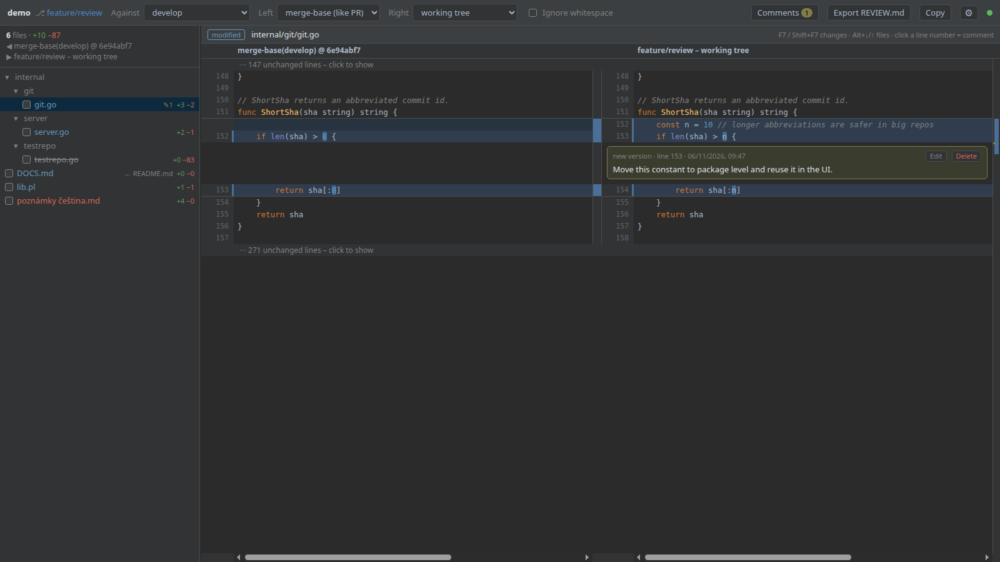
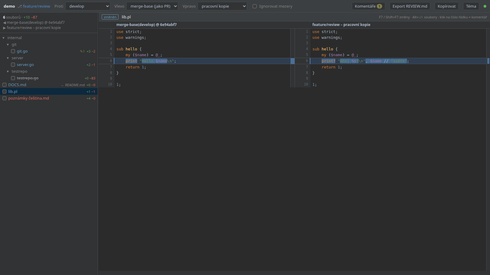
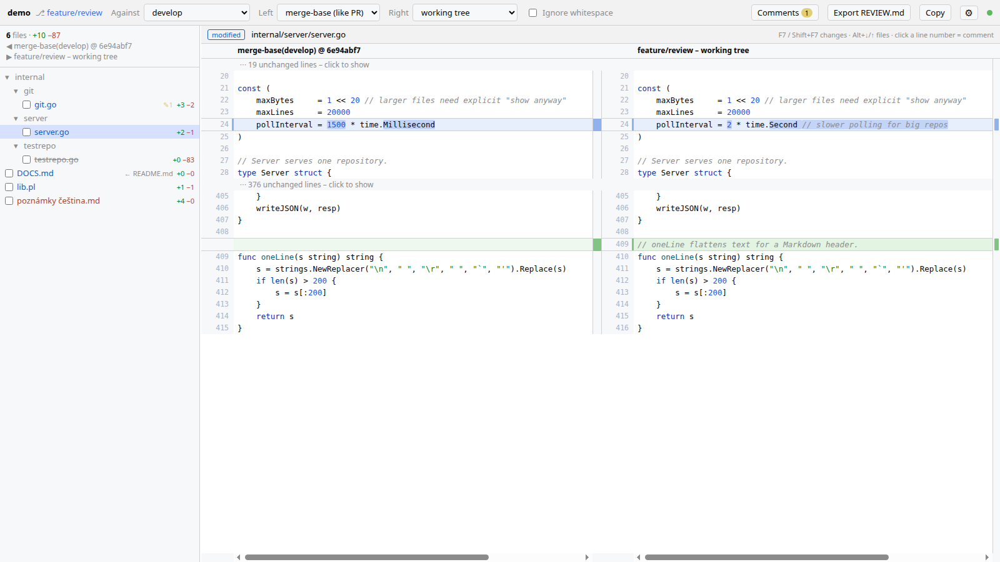
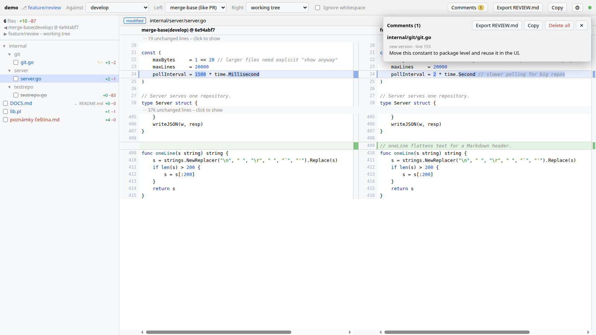

# gitreview

[](https://github.com/JanVrana/gitreview/releases/latest)
[](go.mod)
[](LICENSE)


**English** · [Čeština](README.cs.md)

A web UI for reviewing the changes of your current git branch against `develop` / `master`, with an IntelliJ-style side-by-side diff (original on the left, changes on the right).

It was built for reviewing the work of AI coding agents such as Claude Code running on a remote VM, where desktop diff tools are not at hand. Open the page from your own browser, leave comments on lines, and hand them back to the agent as a `REVIEW.md` file.

gitreview is a single Go binary with no dependencies besides `git`. The frontend is embedded and works offline, with no CDN.



<table>
<tr>
<td><br><sub>Changed words highlighted inside lines</sub></td>
<td><br><sub>Light theme with folded unchanged regions</sub></td>
<td><br><sub>Comments panel and REVIEW.md export</sub></td>
</tr>
</table>

## Install

Linux / macOS (amd64, arm64):

```bash
curl -fsSL https://raw.githubusercontent.com/JanVrana/gitreview/main/install.sh | sh
```

The [script](install.sh) downloads the latest release binary, verifies its SHA-256 checksum and installs it to `~/.local/bin`. Set `GITREVIEW_INSTALL_DIR` for another directory or `GITREVIEW_VERSION=v0.2.0` for a specific release, for example:

```bash
curl -fsSL https://raw.githubusercontent.com/JanVrana/gitreview/main/install.sh | GITREVIEW_INSTALL_DIR=/usr/local/bin sudo -E sh
```

Without the script, download the binary directly:

```bash
mkdir -p ~/.local/bin && curl -fL -o ~/.local/bin/gitreview \
  "https://github.com/JanVrana/gitreview/releases/latest/download/gitreview-$(uname -s | tr A-Z a-z)-$(uname -m | sed 's/x86_64/amd64/;s/aarch64/arm64/')" \
  && chmod +x ~/.local/bin/gitreview && gitreview -version
```

If `~/.local/bin` is not on your `PATH`, put the binary somewhere else, for example `/usr/local/bin` with `sudo`. Every release includes a `SHA256SUMS` file.

With Go 1.26 or newer:

```bash
go install github.com/JanVrana/gitreview@latest
```

Go puts the binary into `$(go env GOBIN)`, or `$(go env GOPATH)/bin` when `GOBIN` is not set. That is usually `~/go/bin/gitreview`, and `~/go/bin` is often not on `PATH`. Run it by its full path, or add the directory to `PATH`:

```bash
~/go/bin/gitreview -version                                   # run directly
echo 'export PATH="$(go env GOPATH)/bin:$PATH"' >> ~/.bashrc  # or add to PATH (zsh: ~/.zshrc)
source ~/.bashrc && gitreview -version
```

From source: `git clone https://github.com/JanVrana/gitreview && cd gitreview && make build`.

gitreview **updates itself** (see [Automatic updates](#automatic-updates)); `gitreview -update` updates right away. Running the install command again works too.

## Usage

```bash
gitreview /path/to/repo          # defaults: current directory, port 8765, 0.0.0.0
gitreview -p 9000 -b 127.0.0.1 .
```

On startup it prints the URLs it is reachable on (the machine's IP addresses), each with an access token, e.g. `http://192.168.1.20:8765/?token=3f9c…`. Open one of them in your browser. The browser keeps the token in a cookie, so later visits to the plain address work too.

| Flag | Meaning |
|---|---|
| `-p` | port (default `8765`) |
| `-b` | listen address (default `0.0.0.0`) |
| `-allow-host` | extra host names accepted in the `Host` header, comma separated |
| `-token` | fixed access token instead of a random one (also `GITREVIEW_TOKEN`); keeps bookmarks working across restarts |
| `-no-auth` | no access token: anyone who can reach the port can use the UI |
| `-no-auto-update` | do not install new releases automatically (also `GITREVIEW_NO_AUTO_UPDATE=1`) |
| `-update` | install the latest release now and exit |
| `-version` | print the version and exit |

### Review loop with an AI agent

1. Let the agent work on a branch.
2. Open gitreview, go through the changed files and click a line number to leave a comment.
3. Click **Export REVIEW.md**. This writes all comments with code snippets to `REVIEW.md` in the repository root. **Copy** copies the same text to the clipboard instead.
4. Tell the agent: *"address the comments in REVIEW.md"*.
5. The page refreshes by itself as the agent edits files. Comments whose line has changed are marked as stale.

## Automatic updates

A running gitreview checks GitHub for a new release 30 seconds after start and then every 6 hours. When one is available it:

1. downloads the binary for your platform and verifies it against the release's `SHA256SUMS`,
2. replaces its own executable (atomically, in the same directory),
3. restarts in place with the same arguments, port and access token.

Open pages reconnect and reload into the new version by themselves. If you are typing a comment, the reload waits until you save or cancel it.

- Development builds (`make build` from a working copy, version `dev` or `v…-dirty`) never update themselves.
- The directory with the binary must be writable by the user running gitreview (true for `~/.local/bin` and `~/go/bin`; not for `/usr/local/bin` installed with `sudo`). Otherwise the update is skipped and the reason is logged.
- Turn it off with `-no-auto-update` or `GITREVIEW_NO_AUTO_UPDATE=1`.
- **⚙ → Check for updates** checks right away and offers **Update now** (works with automatic updates turned off too).

## Security

Every request needs the **access token**. By default a random token is generated at each start and printed in the URLs; set a fixed one with `-token` or `GITREVIEW_TOKEN` (prefer the variable, command-line arguments are visible in `ps`). The token is accepted as `?token=` (exchanged for an HttpOnly cookie and removed from the address bar), as the cookie, or as `Authorization: Bearer <token>` for scripts.

`-no-auth` turns the token off, for example on a private VM or behind an SSH tunnel (`-b 127.0.0.1` + `ssh -L 8765:localhost:8765 vm`). The server runs over plain http, so on an untrusted network the token can be sniffed; use the tunnel there.

Further protections, also active with `-no-auth`:

- Writes (comments, export) are accepted only as same-origin JSON requests, so a foreign web page open in your browser cannot inject text into `REVIEW.md`.
- To prevent DNS rebinding, the `Host` header must be an IP address, `localhost` or the machine's hostname. Allow other names with `-allow-host vm.example.com,dev-vm`.
- Only files from the list of changed files can be read.
- On its own the server does not touch your working tree or the checked-out branch: it writes `REVIEW.md`, `.git/gitreview/comments.json` and, on **Fetch**, remote-tracking branches and fast-forwards of local base branches. Everything else (commit, revert, push, pull, stash) happens only when you click it, see [Git operations](#git-operations).

## Features

- **Comparison:**
  - base `develop` / `master` / `main` / any branch (falls back to `origin/<branch>`),
  - left side: *merge-base* (like a pull request) or the *tip of the base branch*,
  - right side: *working tree* (including uncommitted and untracked files) or *HEAD*,
  - an *ignore whitespace* toggle.
- **Fetch:** runs `git fetch --all --prune` and fast-forwards the local `develop` / `master` / `main` (and the selected base) to their remote-tracking branches, so you compare against the current remote state, not a stale local copy. A branch with local commits or one that is checked out is left alone and reported. When the local base is behind its remote (as of the last fetch), `↓N` appears next to the base selector. Fetch needs non-interactive credentials (ssh agent, credential helper); it never prompts.
- **File tree:** IntelliJ-style status colors, +/− line counts and a "reviewed" checkbox that clears itself when the file changes again.
- **Diff:**
  - aligned change blocks with similar lines paired, changed words highlighted and syntax highlighting (highlight.js),
  - folded unchanged regions; the **⇕ Whole file** button expands the whole file (remembered),
  - **↑ / ↓** buttons with a change counter (3 / 12) to jump between changes,
  - a change overview ruler on the right,
  - independent horizontal scrolling of each side.
- **Auto-refresh:** when files change, a commit is made or the branch is switched, the UI reloads by itself (polling about every 1.5 s, pushed over SSE).
- **Review comments:**
  - stored in `.git/gitreview/comments.json`,
  - `REVIEW.md` is added to `.git/info/exclude` automatically, so it never gets committed,
  - copying to the clipboard works over plain http too.
- **Settings (⚙):** dark (Darcula) or light theme, English or Czech UI. The language defaults to your browser's; the exported `REVIEW.md` follows the UI language.

## Git operations

Basic operations to finish a review without a terminal. Another agent may be working in the same repository at the same time, so none of them forces anything:

- **Commit (n):** opens a panel with the uncommitted files (staged, unstaged and new). Untick what should stay out, write a message, Commit (Ctrl+Enter). Only the ticked files are committed; other staged changes stay staged. If HEAD moved since the panel was loaded (someone committed meanwhile), the commit is refused.
- **↶ Revert:** in the commit panel or in the diff header of an uncommitted file. Discards its uncommitted changes (a new file is deleted) after an inline confirmation.
- **Push:** pushes the current branch; without an upstream it creates `origin/<branch>` and sets it (`-u`). Never forced, a rejected push is reported. `↑N ↓M` next to the branch shows what there is to push and pull (as of the last fetch).
- **Pull:** `git pull --ff-only`. A diverged branch or a pull that would overwrite uncommitted files is refused by git and reported.
- **Stash:** stashes are listed in the *Against* selector. Choosing one shows what it contains (against the commit it was made on, including untracked files of `stash -u`) with the same diff view. **Apply**, **Pop** and **Drop** act on it; Apply/Pop are refused when a file of the stash has uncommitted changes, Pop and Drop ask for confirmation. Creating stashes is intentionally not offered.

Only one git operation runs at a time. Commits use your normal git identity and run the repository's hooks; push and pull need non-interactive credentials (ssh agent, credential helper).

## Key bindings

| Key | Action |
|---|---|
| F7 / Shift+F7 | next / previous change (continues into the next file) |
| Alt+↓ / Alt+↑ | next / previous file |
| click a line number | add a comment |
| Ctrl+Enter / Esc | save / cancel a comment |
| Shift+wheel | scroll the side under the cursor horizontally |

## Development

```bash
make test   # go test ./...
make vet
make dist   # release binaries in dist/ (gitreview-<os>-<arch> + SHA256SUMS)
```

Layout:
- `internal/git`: git CLI calls (`--no-optional-locks`, no shell, ref and path validation)
- `internal/diff`: turns `git diff -U0` into aligned blocks
- `internal/review`: comments and export
- `internal/lang`: file-to-language mapping (syntax highlighting and export)
- `internal/server`: HTTP API, CSRF and DNS-rebinding protection, shared SSE watcher
- `web/`: vanilla JS frontend

## License

[MIT](LICENSE). The bundled [highlight.js](https://highlightjs.org/) (`web/vendor/`) is licensed under BSD-3-Clause.
